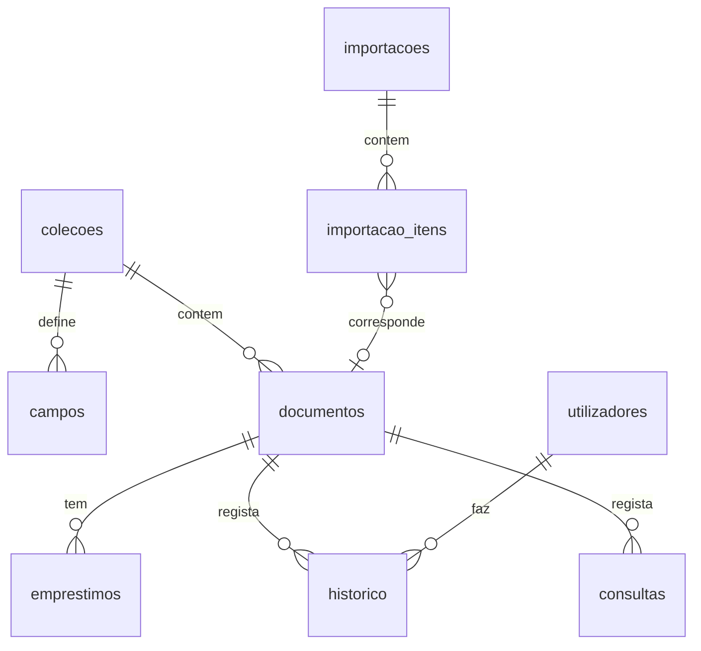
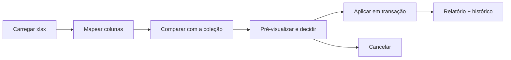

# Plano de melhorias SIGAT (para execução por agente)

> **Estado: implementado (Fases 0–6).** O que foi feito difere ligeiramente do desenho em alguns pontos: a fusão de importações guarda os ficheiros em `data/importacoes/` até serem aplicados/cancelados; `Painel`, `Empréstimos` e `Importações` são componentes Vue; as decisões D1–D8 usaram os valores por omissão. Ver [decisions.md](decisions.md) (16–27).

Documento de trabalho para um agente implementar. Ler antes: [README.md](README.md), [architecture.md](architecture.md), [data-model.md](data-model.md), [limitations.md](limitations.md).

Pedido do negócio:
1. Exportar resultados (Excel/CSV), incluindo a pesquisa filtrada.
2. Empréstimos completos: devolução prevista e efetiva, requisitante visível, lista "em atraso", alertas.
3. Painel de indicadores: documentos por estado, empréstimos ativos, mais consultados, qualidade dos dados.
4. Atualização incremental a partir do Excel: comparar, mostrar diferenças, preservar estados e edições.
5. Pesquisa tolerante a acentos/maiúsculas, palavras parciais e relevância.

---

## 1. Análise de impacto

### 1.1 Problema estrutural (bloqueia 2, 3 e 4)
O modelo atual é **"cada importação = um dataset independente"**:
- A identidade de uma entrada é `sourceEntryNumber` = nº da linha no ficheiro. **Não é estável** entre importações.
- Estados, empréstimos, edições e histórico vivem **dentro** do dataset. Reimportar cria outro dataset e perde tudo (hoje há 3 datasets de Cartografia quase iguais: `Mapa`, `mapa2026` (com 142 entradas de histórico) e `Cartografia GEO - BD`; e 2 de ATURB).
- O utilizador tem de escolher "a fonte" antes de pesquisar: não existe uma verdade única.
- Persistência em JSON lido/escrito inteiro em cada pedido, sem transações nem locking.

Consequências por pedido:
| # | Pedido | Viável no modelo atual? | Porquê |
|---|---|---|---|
| 1 | Exportar | Sim | Só precisa de reutilizar o filtro existente. |
| 5 | Pesquisa | Sim | Lógica em memória; independente do armazenamento. |
| 2 | Empréstimos | Mal | Um empréstimo tem de sobreviver a reimportações e ter histórico próprio (vários empréstimos por documento). Exige ID estável. |
| 3 | Indicadores | Parcial | Contagens sim; "mais consultados" exige registo de consultas ligado a um ID estável. |
| 4 | Atualização incremental | Não | Exige identidade estável, chave de correspondência, valores importados vs. editados, transações. |

### 1.2 Mudanças profundas recomendadas
**A. Base de dados SQLite** (via `better-sqlite3`), ficheiro `data/sigat.db` no mesmo volume Docker.
- Porquê: transações (aplicar importação tudo-ou-nada), WAL (leituras concorrentes com escrita), integridade (índices únicos, FK), consultas agregadas para o painel, backup = 1 ficheiro. Sem servidor extra; o deploy continua um contentor.
- Alternativa "BD oficial" (PostgreSQL / SQL Server da CML): só se a DSI exigir BD central gerida, várias instâncias ou integração com outros sistemas. Para manter essa porta aberta, **todo o SQL fica isolado em `src/db/`** (repositórios), sem SQL nas rotas. Volume atual (~4,6 mil documentos) não justifica servidor de BD.

**B. Fim das "várias fontes de dados" → uma coleção por tipo + importações.**
- Coleções fixas: `cartografia` e `aturb`. Cada coleção tem **um** conjunto de documentos, persistente.
- Um ficheiro Excel deixa de "criar uma fonte": cria uma **importação** (lote) que é comparada com a coleção, pré-visualizada e aplicada.
- O ecrã "Fontes de Dados" passa a "Importações". As páginas de pesquisa deixam de ter seletor de fonte.
- O SIGAT passa a ser a **fonte de verdade** para estados, empréstimos e edições; o Excel serve para cargas e atualizações em massa.

**C. Identidade e duplicados.**
- `id` (UUID interno) + `numero` (inteiro por coleção, visível, nunca reutilizado; substitui `sourceEntryNumber`).
- Correspondência na importação, por ordem: `ID SIGAT` (coluna do ficheiro, se existir) → `Nº Registo` → cota+descrição normalizadas → descrição única → cota única. Vários candidatos = **ambíguo** (decisão manual).
- A exportação Excel inclui a coluna `ID SIGAT` → ciclo **exportar → editar no Excel → reimportar** casa 100 %.

**D. Campos dinâmicos.**
- Registo de campos por coleção (tabela `campos`): chave, rótulo, tipo, aliases de cabeçalho, visível/pesquisável/filtro numérico/obrigatório.
- Valores em `documentos.dados` (JSON). Colunas novas no Excel podem ser mapeadas para um **campo novo** no assistente de importação, sem alterar código. Resolve também colunas hoje ignoradas (TB 2, MP, CDR 2, Restauro; e as muitas colunas do `bdarquivotecnico.xlsx` no ATURB).

**E. Preservação de edições (fusão a 3 vias).** Cada documento guarda `dados_importados` (valores da última importação aplicada). Para cada campo:
- atual == importado-anterior → aplica o valor do ficheiro (ninguém editou no SIGAT);
- ficheiro == importado-anterior → mantém o atual (só o SIGAT mudou);
- ambos mudaram e diferem → **conflito** (por omissão mantém SIGAT; utilizador decide).
- Estado e empréstimos **nunca** são sobrescritos pela importação (salvo documento sem empréstimo registado e coluna Empréstimo=Sim → cria empréstimo "importado").

### 1.3 Outras alterações necessárias (encontradas na análise)
- `xlsx` 0.18.5 do npm tem vulnerabilidades conhecidas (prototype pollution, ReDoS) e processa ficheiros carregados por utilizadores → atualizar para SheetJS ≥ 0.20.x (distribuído em `https://cdn.sheetjs.com/`, não no npm). Verificar a versão atual e a forma de instalação na documentação oficial.
- `POST /datasets/:id/activate` sem verificação de role; `write` pode carregar/apagar datasets via API. Resolver no novo modelo (importar = `admin`).
- `PUT` não permite limpar campos; validação só no frontend; campos arbitrários aceites. Resolver com o registo de campos.
- `sourceEntryNumber` pode colidir após restauro. Resolvido com `numero` monótono.
- Histórico guarda entradas completas → guardar só o diff.
- `JWT_SECRET` por omissão e `admin/admin123` sem troca obrigatória.
- `App.vue` com ~3 400 linhas: **não reescrever**; as funcionalidades novas entram como componentes novos.
- Não há testes: criar base mínima com `node:test` antes de migrar.
- `datasets.json` atual tem `activeDatasetId` inexistente e um dataset (`mapa2`) sem ficheiro → a migração tem de tolerar isto.

---

## 2. Arquitetura alvo



### 2.1 Esquema SQLite (`src/db/migrations/001_inicial.sql`)
```sql
PRAGMA journal_mode = WAL;
PRAGMA foreign_keys = ON;

CREATE TABLE schema_migrations (versao INTEGER PRIMARY KEY, aplicada_em TEXT NOT NULL);

CREATE TABLE utilizadores (
  id TEXT PRIMARY KEY, username TEXT NOT NULL UNIQUE COLLATE NOCASE,
  role TEXT NOT NULL CHECK (role IN ('admin','write','read')),
  password_hash TEXT NOT NULL, criado_em TEXT NOT NULL,
  trocar_password INTEGER NOT NULL DEFAULT 0
);

CREATE TABLE colecoes (id TEXT PRIMARY KEY, nome TEXT NOT NULL);   -- 'cartografia','aturb'

CREATE TABLE campos (
  colecao TEXT NOT NULL REFERENCES colecoes(id), chave TEXT NOT NULL,
  rotulo TEXT NOT NULL, tipo TEXT NOT NULL DEFAULT 'texto',        -- texto|numero|data
  ordem INTEGER NOT NULL DEFAULT 0, aliases TEXT NOT NULL DEFAULT '[]', -- cabeçalhos xlsx normalizados (JSON)
  visivel_tabela INTEGER NOT NULL DEFAULT 0, pesquisavel INTEGER NOT NULL DEFAULT 1,
  filtro_numerico INTEGER NOT NULL DEFAULT 0, obrigatorio INTEGER NOT NULL DEFAULT 0,
  peso_pesquisa REAL NOT NULL DEFAULT 1, sistema INTEGER NOT NULL DEFAULT 0,
  PRIMARY KEY (colecao, chave)
);

CREATE TABLE documentos (
  id TEXT PRIMARY KEY, colecao TEXT NOT NULL REFERENCES colecoes(id),
  numero INTEGER NOT NULL,
  dados TEXT NOT NULL,                 -- JSON {campo: valor}
  dados_importados TEXT,               -- JSON da última importação aplicada (base da fusão a 3 vias)
  estado TEXT NOT NULL DEFAULT '-',    -- '-','Arquivo','Em Consulta','Empréstimo' (desnormalizado p/ filtros)
  importacao_id TEXT,                  -- última importação que tocou o documento
  criado_em TEXT NOT NULL, criado_por TEXT NOT NULL,
  atualizado_em TEXT, atualizado_por TEXT,
  eliminado_em TEXT, eliminado_por TEXT,
  UNIQUE (colecao, numero)
);
CREATE INDEX idx_doc_colecao ON documentos(colecao, eliminado_em);
CREATE INDEX idx_doc_nrregisto ON documentos(colecao, json_extract(dados,'$.nrRegisto'));

CREATE TABLE emprestimos (
  id TEXT PRIMARY KEY, documento_id TEXT NOT NULL REFERENCES documentos(id),
  requisitante TEXT NOT NULL, entidade TEXT, contacto TEXT,
  data_saida TEXT NOT NULL,            -- YYYY-MM-DD
  data_prevista TEXT,                  -- YYYY-MM-DD; NULL só em empréstimos importados/migrados
  data_devolucao TEXT,                 -- NULL = ativo
  observacoes TEXT, observacoes_devolucao TEXT,
  origem TEXT NOT NULL DEFAULT 'sigat', -- sigat|importacao|migracao
  registado_por TEXT NOT NULL, registado_em TEXT NOT NULL,
  devolucao_registada_por TEXT, devolucao_registada_em TEXT
);
CREATE UNIQUE INDEX ux_emprestimo_ativo ON emprestimos(documento_id) WHERE data_devolucao IS NULL;

CREATE TABLE consultas (
  id INTEGER PRIMARY KEY AUTOINCREMENT, documento_id TEXT NOT NULL REFERENCES documentos(id),
  tipo TEXT NOT NULL,                  -- visualizacao|presencial|emprestimo
  utilizador TEXT NOT NULL, em TEXT NOT NULL
);
CREATE INDEX idx_consultas_doc ON consultas(documento_id, em);

CREATE TABLE historico (
  id TEXT PRIMARY KEY, colecao TEXT NOT NULL, documento_id TEXT,
  acao TEXT NOT NULL,                  -- criar|editar|eliminar|restaurar|estado|emprestimo|devolucao|prolongar|importar|exportar
  utilizador TEXT NOT NULL, em TEXT NOT NULL,
  importacao_id TEXT, detalhes TEXT NOT NULL DEFAULT '{}' -- JSON: só campos alterados {campo:{de,para}}
);
CREATE INDEX idx_hist_doc ON historico(documento_id, em);
CREATE INDEX idx_hist_colecao ON historico(colecao, em);

CREATE TABLE importacoes (
  id TEXT PRIMARY KEY, colecao TEXT NOT NULL, ficheiro_nome TEXT NOT NULL,
  ficheiro_sha256 TEXT NOT NULL, tamanho INTEGER NOT NULL,
  estado TEXT NOT NULL,                -- previsualizacao|aplicada|cancelada|expirada
  mapeamento TEXT NOT NULL,            -- JSON {indiceColuna: {campo|novoCampo|ignorar}}
  resumo TEXT, erros TEXT, avisos TEXT,
  criada_em TEXT NOT NULL, criada_por TEXT NOT NULL,
  aplicada_em TEXT, aplicada_por TEXT
);

CREATE TABLE importacao_itens (
  importacao_id TEXT NOT NULL REFERENCES importacoes(id) ON DELETE CASCADE,
  linha INTEGER NOT NULL,
  acao TEXT NOT NULL,                  -- novo|alterado|igual|conflito|ambiguo|duplicado_ficheiro|erro
  documento_id TEXT, candidatos TEXT,  -- JSON ids (ambíguo)
  criterio TEXT,                       -- id_sigat|nr_registo|cota_descricao|descricao|cota
  dados_ficheiro TEXT NOT NULL,        -- JSON
  diff TEXT,                           -- JSON {campo:{atual,ficheiro,base,conflito:bool}}
  decisao TEXT,                        -- JSON escolhida pelo utilizador
  PRIMARY KEY (importacao_id, linha)
);
```
Notas: `numero` novo = `MAX(numero)+1` da coleção **incluindo eliminados** (dentro da transação). Datas sempre ISO `YYYY-MM-DD` na BD, `dd/mm/aaaa` na UI.

### 2.2 Estrutura de código alvo
```
server.js                       bootstrap (app.listen só se require.main === module; exporta app)
src/db/index.js                 abre BD, aplica migrações, helper transaction()
src/db/migrations/*.sql
src/db/repos/{documentos,emprestimos,importacoes,historico,campos,utilizadores,consultas}.js
src/search.js                   normalizar, tokenizar, filtrar, pontuar, ordenar (puro, sem I/O)
src/query.js                    queryDocumentos(docs, campos, query) -> {total, items}  (usa search.js)
src/export.js                   gerar xlsx/csv a partir de linhas + definição de colunas
src/import/{ler.js,corresponder.js,comparar.js,aplicar.js}
src/parsers/                    parserCartografiaXlsx.js, parserXlsx.js (movidos; parser.js TXT removido)
src/routes/{auth,users,documentos,emprestimos,importacoes,indicadores,exportar}.js
scripts/migrar-json-para-sqlite.js
test/*.test.js                  node:test
frontend/src/api.js             apiFetch + download de ficheiros (extraído de App.vue)
frontend/src/components/{ExportarBotao,Emprestimos,EmprestimoModal,DevolucaoModal,Painel,ImportacaoAssistente}.vue
```

### 2.3 API alvo (substitui `/datasets` e `/entries`)
| Método | Rota | Role | Notas |
|---|---|---|---|
| GET | `/api/colecoes/:colecao/campos` | any | definição de campos (UI dinâmica) |
| POST/PATCH | `/api/colecoes/:colecao/campos[/:chave]` | admin | criar/editar campo (rótulo, visível, pesquisável) |
| GET | `/api/colecoes/:colecao/documentos` | any | `q`, filtros por campo, `vazios=cota,autor`, `estado`, `emprestimo=ativo|atraso`, `sortKeys`, `page`, `pageSize`, `ordenar=relevancia` |
| GET | `/api/colecoes/:colecao/documentos/distinct` | any | `field`, `q` |
| GET | `/api/colecoes/:colecao/exportar` | any | mesmos parâmetros + `formato=xlsx|csv`, `colunas=` |
| POST | `/api/colecoes/:colecao/documentos` | admin,write | criar (validação servidor) |
| GET | `/api/documentos/:id` | any | detalhe + empréstimo ativo + regista `consultas(visualizacao)` |
| PUT | `/api/documentos/:id` | admin,write | substitui `dados` (valor `''`/null limpa o campo) |
| PATCH | `/api/documentos/:id/estado` | admin,write | `Arquivo`/`Em Consulta`/`-`; `Empréstimo` → 400 (usar rota de empréstimos) |
| DELETE / POST `/restaurar` | `/api/documentos/:id` | admin,write | soft-delete / restauro |
| GET | `/api/colecoes/:colecao/eliminados` | admin,write | |
| GET | `/api/documentos/:id/historico`, `/api/colecoes/:colecao/historico` | admin,write | |
| GET | `/api/emprestimos` | any | `estado=ativo|atraso|devolvido|todos`, `colecao`, `requisitante`, `de`, `ate`, paginação |
| POST | `/api/documentos/:id/emprestimos` | admin,write | cria; 409 se já houver ativo |
| POST | `/api/emprestimos/:id/devolver` | admin,write | `{data_devolucao, observacoes_devolucao}` |
| PATCH | `/api/emprestimos/:id` | admin,write | prolongar/corrigir (`data_prevista`, requisitante…) |
| GET | `/api/emprestimos/resumo` | any | `{ativos, emAtraso, aVencer7dias}` para alertas |
| GET | `/api/indicadores?colecao=` | any | ver Fase 5 |
| POST | `/api/colecoes/:colecao/importacoes` | admin | multipart → lê ficheiro, propõe mapeamento |
| PUT | `/api/importacoes/:id/mapeamento` | admin | confirma mapeamento → calcula comparação |
| GET | `/api/importacoes`, `/api/importacoes/:id`, `/api/importacoes/:id/itens?acao=` | admin | |
| PATCH | `/api/importacoes/:id/itens/:linha` | admin | decisão por item |
| POST | `/api/importacoes/:id/aplicar` | admin | transação única |
| DELETE | `/api/importacoes/:id` | admin | cancela pré-visualização |

---

## 3. Fases de implementação

Regras gerais para o agente:
- UI, mensagens e nomes de domínio em **pt-PT**. Código novo em JS CommonJS (backend) e Vue 3 `<script setup>` (frontend), como o existente.
- Não reescrever `App.vue`; criar componentes novos e ligá-los ao `App.vue` (nav + `currentPage`). Extrair só o necessário (`apiFetch`).
- Cada fase termina com: `npm test` verde, `npm run build:client`, verificação manual (checklist da fase), atualização de `knowledge/` (ficheiros afetados + `decisions.md`), **commit local** (sem push).
- Antes da Fase 2: cópia de segurança de `data/` (`data-backup-AAAAMMDD/`), nunca apagar os JSON originais.
- Não adicionar dependências além das indicadas sem justificação.

### Fase 0 — Preparação e segurança base
1. `server.js`: exportar `app`; `listen` só quando `require.main === module`.
2. Testes com `node:test` + `fetch` nativo contra o `app` numa porta aleatória e `DATA_DIR` temporário (tornar `DATA_DIR` configurável por env `SIGAT_DATA_DIR`). Script `"test": "node --test test/"`.
3. Testes de caracterização mínimos do comportamento atual: login, `GET /entries` com filtro numérico (`cota=12` não casa `123`), ordenação de cota, parse do xlsx de Cartografia com fixture gerado no teste via SheetJS (cabeçalhos reais listados em [data-model.md](data-model.md)).
4. Atualizar SheetJS para versão sem as CVE conhecidas (confirmar versão e método de instalação na documentação oficial SheetJS); correr testes.
5. Remover dependência `uuid` não usada.
6. Corrigir `POST /datasets/:id/activate` → `requireRole('admin','write')`.
7. Em `NODE_ENV=production`, recusar arranque se `JWT_SECRET` não estiver definido ou for o default.

Aceitação: `npm test` passa; app funciona como antes.

### Fase 1 — Pesquisa (pedido 5) e Exportação (pedido 1) — sobre o armazenamento atual
Implementadas como módulos **puros** para serem reutilizados sem alterações depois da migração.

**1a. `src/search.js`**
- `normalizar(s)`: `String(s ?? '').normalize('NFD').replace(/\p{M}/gu, '').toLowerCase()`; para tokenizar, substituir pontuação por espaço (manter `/` `.` `-` dentro de cotas como separadores).
- `analisarQuery(q)`: tokens por espaço; `"frase exata"` entre aspas; `-termo` exclui. Tokens vazios ignorados.
- Correspondência por token (todos os tokens têm de corresponder em pelo menos um campo pesquisável — AND):
  - token só com dígitos → corresponde a **número inteiro** igual dentro do campo (coerente com a decisão 7); 
  - outro token → início de palavra (prefixo) ou substring.
- Pontuação: por token e campo, palavra exata = 3, prefixo = 2, substring = 1, multiplicado por `peso` do campo. Pesos iniciais Cartografia: cabecalho 3, descricao 3, assuntos 2.5, autor 2, cota 3, nrRegisto 3, localizacao 1.5, notas 1, restantes 1. ATURB: titulo 3, autor 2, local 1.5, caixaNr 3, data 1. Bónus +5 se a frase completa normalizada aparecer num campo.
- Filtros por campo passam a usar `normalizar` (acentos/maiúsculas) mantendo a regra numérica exata para `cota, cdr, tb, nrRegisto, caixaNr`.
- Cache: índice normalizado por documento guardado em memória por dataset, invalidado quando o ficheiro/coleção muda (mtime agora; contador de versão depois da Fase 2).
- Ordenação: se `q` presente e o utilizador não escolheu `sortKeys` → relevância desc, desempate por `cabecalho/titulo`. Responder `ordenacao: 'relevancia'|'campos'`.

**1b. `src/query.js`**: extrair de `GET /api/entries` a lógica de filtro+ordenação para `queryEntries(entries, definicaoCampos, query)`; `GET /entries`, `/entries/distinct` e exportação usam-na. Definição de campos por tipo num objeto constante agora (passará a vir da tabela `campos` na Fase 2). Novo filtro `vazios=campo1,campo2` (campo vazio/só espaços) — usado depois pelo painel.

**1c. Frontend pesquisa**: indicador "Ordenado por relevância" com botão para limpar; ao clicar num cabeçalho passa a ordenação por campos. Texto de ajuda curto junto da caixa de pesquisa (aspas, `-termo`).

**1d. `src/export.js` + rota `GET /api/entries/export`** (`datasetId`, todos os filtros, `formato=xlsx|csv`, `colunas=` opcional):
- Sem paginação (limite de segurança 100 000 linhas → 413).
- Colunas com rótulos pt-PT; por omissão todas as do tipo + Estado, Requisitante, Data saída (e, depois da Fase 3, Data prevista/Devolução) + **`ID SIGAT`** (`sourceEntryNumber` agora, `numero` depois).
- xlsx: `xlsx.utils.json_to_sheet` + segunda folha "Critérios" (data/hora, utilizador, coleção, filtros e pesquisa aplicados, total). Largura de colunas razoável (`!cols`), cabeçalho fixo (`!freeze` se suportado).
- CSV: UTF-8 com BOM, separador `;` (Excel pt-PT), aspas duplas com escape.
- **Proteção contra CSV/Formula injection**: valores começados por `=`, `+`, `-`, `@`, tab ou CR prefixados com `'` (xlsx e CSV).
- `Content-Disposition: attachment; filename="sigat-<colecao>-AAAAMMDD-HHmm.<ext>"`.
- Registar ação `exportar` no histórico (filtros + total), sem dados.
- Frontend: componente `ExportarBotao.vue` (menu Excel/CSV) nas páginas Cartografia e ATURB, a usar os filtros/pesquisa/ordenação atuais; download via `fetch` com Bearer → `Blob` → `URL.createObjectURL` (não usar link direto: precisa do header). Também no carrinho de impressão (exportar selecionados → passar `ids=`).

Testes: "lisbôa"↔"Lisboa", "CAMARA"↔"Câmara", "plan lisb" casa "Planta de Lisboa", relevância (match no cabeçalho acima de match nas notas), `-termo` exclui, `"frase"`, numérico exato em `q`; exportação: nº de linhas = `total` da pesquisa, BOM e `;` no CSV, célula `=SUM(1)` exportada como `'=SUM(1)`.

### Fase 2 — Migração para SQLite e modelo "coleção única" (fundação)
1. Adicionar `better-sqlite3`. Confirmar que `docker compose build` funciona em `node:20-alpine` (se não houver binário pré-compilado para musl, adicionar `apk add --no-cache python3 make g++` num stage de build, ou mudar para `node:20-slim`).
2. `src/db/index.js`: abrir `SIGAT_DATA_DIR/sigat.db`, `PRAGMA journal_mode=WAL; foreign_keys=ON; busy_timeout=5000`, aplicar migrações por ordem, `transaction(fn)`.
3. Seed de `colecoes` e `campos` (sistema) com os campos atuais, rótulos, aliases de cabeçalho (os de `COLUMNS` em `parserCartografiaXlsx.js`; ATURB: Autor, Título, Local, Data, Caixa nº, Estado), pesos de pesquisa, `filtro_numerico`, `obrigatorio` (Cartografia: cabecalho, descricao, cota, autor; ATURB: titulo, autor, local, data, caixaNr), `visivel_tabela` conforme a tabela atual.
4. **Script `scripts/migrar-json-para-sqlite.js`** (idempotente, `--dry-run` por omissão, `--aplicar` para gravar):
   - Utilizadores de `users.json` (mantém hashes).
   - Por coleção, escolher o dataset **canónico** (ver decisão D1): por omissão Cartografia = `Cartografia GEO - BD` (mais recente, Localização correta), ATURB = `arquivo2026` (mais recente, com edições).
   - Documentos do canónico: `numero = sourceEntryNumber`, `dados` = campos do registo de campos, `dados_importados` = mesmos valores, estado.
   - **Recuperar trabalho dos outros datasets da mesma coleção** (ex.: `mapa2026` tem 142 eventos de histórico): casar documentos com o algoritmo da Fase 4 (nrRegisto → cota+descrição → …); para cada documento casado com edições manuais (`updatedAt`) ou estado ≠ `-` mais recente que o do canónico, aplicar o estado/edição e registar no relatório. Histórico antigo migrado para `historico` (convertendo `prev/next` em diff) com `detalhes.origem='migracao'` e nome do dataset.
   - `Empréstimo` existente → linha em `emprestimos` (`origem='migracao'`, `data_prevista` NULL, `requisitante` = `estadoMeta.requisitante` ou `'(não indicado)'`).
   - Lixo (`deletedEntries`) → documentos com `eliminado_em`.
   - Tolerar `activeDatasetId` inexistente e datasets sem ficheiro.
   - Gerar `data/relatorio-migracao-<data>.md` (contagens, casados, não casados, conflitos).
   - Mover JSON para `data/legacy/` só com `--aplicar` e após sucesso.
   - No arranque: se `sigat.db` não existir e existir `datasets.json`, **não** migrar automaticamente; registar aviso no log a pedir para correr o script.
5. Repositórios em `src/db/repos/`; rotas novas (tabela 2.3, exceto importação/empréstimos/indicadores, que vêm nas fases seguintes). `query.js`/`search.js` recebem `listarDocumentos(colecao)` (cache em memória por coleção com contador de versão incrementado em cada escrita).
6. PUT: validação no servidor contra `campos` (rejeita chaves desconhecidas, valida obrigatórios, `''`/null limpa). Histórico só com diff.
7. Remover rotas `/api/datasets*` e `/api/entries*`, `src/parser.js` e `Mapa.txt` só depois de o frontend estar migrado no mesmo commit/fase.
8. Frontend: remover seletores de fonte; Cartografia/ATURB chamam `/api/colecoes/:colecao/...`; identificador nas ações passa a `id` (mostrar `numero` como "ID SIGAT"); detalhe abre via `GET /api/documentos/:id`. Página "Fontes de Dados" fica temporariamente só com o histórico de importações legadas (ou oculta) até à Fase 4.
9. Backup: documentar em `architecture.md` como fazer backup a quente (`sqlite3 data/sigat.db ".backup ..."` ou `VACUUM INTO`); opcional rota admin `GET /api/admin/backup` que devolve `VACUUM INTO` de um ficheiro temporário.

Aceitação: script em dry-run e depois aplicado sobre uma cópia de `data/`; contagens = canónicos; pesquisa, filtros, edição, estado, lixo, histórico, impressão e exportação funcionam; testes passam; Docker arranca com volume.

### Fase 3 — Empréstimos (pedido 2)
Backend:
- Rotas de empréstimos (2.3). Criar empréstimo: transação → insere `emprestimos`, `documentos.estado='Empréstimo'`, `historico(emprestimo)`, `consultas(emprestimo)`. Devolver: preenche `data_devolucao`, `estado='Arquivo'` (decisão D4), histórico. Prolongar: altera `data_prevista`, histórico com de/para.
- Validações: `requisitante` obrigatório; `data_saida` ≤ hoje (+ tolerância 0); `data_prevista` ≥ `data_saida`; `data_devolucao` ≥ `data_saida`; 409 se já houver ativo.
- `PATCH /documentos/:id/estado` recusa `Empréstimo` e recusa sair de `Empréstimo` (obriga a "Registar devolução").
- Situação calculada (não guardada): `ativo`, `em_atraso` (`data_devolucao IS NULL AND data_prevista < date('now','localtime')`), `sem_prazo` (ativo e `data_prevista` NULL), `devolvido`, `devolvido_com_atraso`.
- Prazo por omissão configurável: env `SIGAT_PRAZO_EMPRESTIMO_DIAS` (default 30).
- `GET /api/emprestimos/resumo` → `{ativos, emAtraso, aVencer7dias, semPrazo}`.
- Filtro na pesquisa de documentos: `emprestimo=ativo|atraso`. Exportação inclui Requisitante, Data saída, Data prevista, Dias de atraso.
- Registo de `consultas(presencial)` quando o estado passa a `Em Consulta`.

Frontend:
- `EmprestimoModal.vue` (substitui o modal atual de data de saída): requisitante (com sugestões de requisitantes anteriores via `distinct`), entidade/serviço, contacto, data de saída (hoje), data prevista (hoje + prazo), observações.
- `DevolucaoModal.vue`: data efetiva (hoje), observações (estado de conservação).
- Tabela e detalhe: estado "Empréstimo" mostra **requisitante** e "até dd/mm/aaaa"; vermelho + "em atraso N dias" se vencido. Detalhe mostra histórico de empréstimos do documento.
- Seletor de estado: se o documento está emprestado, o seletor mostra ações "Registar devolução" / "Prolongar" em vez de estados.
- Nova página **Empréstimos** (menu, todos os perfis veem; ações só write/admin): separadores Ativos / Em atraso / Sem prazo / Histórico; filtros por coleção, requisitante, período; ordenar por data prevista; exportar (reutilizar `ExportarBotao` com rota `GET /api/emprestimos/exportar`).
- **Alertas**: badge vermelho no item de menu com nº em atraso; faixa na topbar após login "N empréstimos em atraso · M vencem nos próximos 7 dias" com link para a página; atualizar ao registar/devolver. (Email fica fora de âmbito — ver secção 5.)

Testes: criar/devolver/prolongar; 409 com ativo; atraso calculado com datas fixas; estado coerente após cada operação; não é possível pôr `Empréstimo` via rota de estado.

### Fase 4 — Importação incremental (pedido 4)
Fluxo (assistente em `ImportacaoAssistente.vue`, página "Importações", só admin):



1. **Ler** (`src/import/ler.js`): generalizar os parsers para "ler tabela + mapear cabeçalhos pelos `aliases` dos campos". Cartografia: procurar folha `BD` e cabeçalho nas 10 primeiras linhas (como hoje). ATURB: passar a usar cabeçalhos (linha 3 hoje) em vez de posições. Manter as derivações específicas (`parseFisica`, `deriveCabecalho`) como transformações por coleção. Guardar SHA-256 do ficheiro e avisar se já foi importado.
2. **Mapear**: para cada coluna do ficheiro propor `campo existente` (por alias), `ID SIGAT`, `novo campo` (chave = slug do cabeçalho, rótulo = cabeçalho original, tipo texto) ou `ignorar`. Colunas de empréstimo (Empréstimo, Data de Saída, Data de Entrada, Requisitante) mapeadas para um tratamento especial (ver passo 5). O admin confirma; o mapeamento escolhido é guardado e os aliases novos são acrescentados ao campo para a próxima vez.
3. **Corresponder** (`corresponder.js`), por ordem, só contra documentos não eliminados (e depois eliminados, para sugerir restauro):
   1. `ID SIGAT` (= `numero`) se a coluna existir;
   2. `nrRegisto` igual;
   3. cota normalizada (reutilizar `normCota`) + descrição normalizada (`normalizar` da Fase 1, espaços colapsados);
   4. descrição normalizada com candidato único;
   5. cota normalizada com candidato único.
   Cada documento da coleção só pode ser atribuído a uma linha. Várias linhas → mesmo documento: a primeira fica, as restantes `duplicado_ficheiro`. Vários candidatos → `ambiguo`. Guardar `criterio`.
4. **Comparar** (`comparar.js`): normalizar valores antes de comparar (trim, espaços, datas). Fusão a 3 vias (secção 1.2 E) por campo → `igual`, `alterado` (só campos aplicáveis sem conflito), `conflito` (pelo menos um campo em conflito), `novo`. Documentos da coleção sem linha no ficheiro → contados como **"ausentes do ficheiro"** (não são itens a aplicar; listados no relatório; nunca eliminados automaticamente — decisão D3).
5. **Empréstimos na importação**: se a linha indica Empréstimo=Sim e o documento **não** tem empréstimo ativo nem empréstimos registados no SIGAT depois da última importação → propor criar empréstimo `origem='importacao'` (requisitante/data saída das colunas). Se "Data de Entrada" estiver preenchida e houver empréstimo ativo importado → propor devolução. Nunca alterar empréstimos com `origem='sigat'`. Mostrar como secção separada na pré-visualização.
6. **Pré-visualizar**: resumo com contagens por ação; separadores por ação com paginação; para `alterado`/`conflito` mostrar tabela campo | valor SIGAT | valor ficheiro | (valor importado anterior), com escolha por campo (SIGAT/ficheiro) e ações em massa ("aceitar todas as alterações sem conflito", "manter SIGAT em todos os conflitos"); para `ambiguo` escolher o documento ou "criar novo"; para `novo` desmarcar linhas. Avisos de qualidade do parse como hoje.
7. **Aplicar** (`aplicar.js`), uma transação: recarregar cada documento e, se `atualizado_em` > `importacoes.criada_em`, recalcular esse item; se passar a conflito, abortar com 409 e pedir nova comparação (não aplicar parcialmente). Criar novos (`numero` novo), atualizar campos escolhidos, atualizar `dados_importados` com os valores do ficheiro para **todos** os campos mapeados dos documentos casados (incluindo os mantidos), criar campos novos, empréstimos importados, `historico(importar)` por documento com `importacao_id`, resumo final. Invalidar cache de pesquisa.
8. Limpeza: pré-visualizações não aplicadas expiram após 24 h (apagar itens ao arrancar/ao criar nova importação). Só uma pré-visualização ativa por coleção.
9. UI de campos: na página Importações, separador "Campos" para o admin renomear rótulo, marcar visível na tabela/pesquisável. Campos não-sistema aparecem automaticamente no detalhe, no formulário de edição, nos filtros avançados (texto) e na exportação.
10. Opcional (4b): "Reverter importação" a partir do histórico com `importacao_id` (só se nenhum documento afetado tiver sido editado depois).

Testes (fixtures xlsx gerados): reimportar o mesmo ficheiro → tudo `igual`; alterar 1 célula → 1 `alterado`; editar no SIGAT e mudar a mesma célula no ficheiro → `conflito`; editar só no SIGAT → `igual` e a edição é preservada; linha nova → `novo`; linha duplicada → `duplicado_ficheiro`; duas candidatas → `ambiguo`; coluna nova → campo novo criado e pesquisável; estados/empréstimos SIGAT intactos após aplicar; ronda exportar→importar com `ID SIGAT` casa todas as linhas.

### Fase 5 — Painel de indicadores (pedido 3)
- `GET /api/indicadores?colecao=cartografia|aturb|todas&periodo=30|90|365|tudo` (agregados SQL; sem dados pessoais para `read` além de contagens):
  - total de documentos (ativos) e eliminados;
  - por estado (`-`, Arquivo, Em Consulta, Empréstimo);
  - empréstimos: ativos, em atraso, sem prazo, a vencer em 7 dias, devolvidos no período, tempo médio de empréstimo;
  - **mais consultados** (top 10): contagem em `consultas` no período por tipo; por omissão `presencial + emprestimo` (decisão D2), com alternância para incluir visualizações. Registo de `visualizacao` com deduplicação (mesmo utilizador+documento em 30 min conta uma vez);
  - **qualidade dos dados**: sem cota, sem autor, sem nº de registo (Cartografia), sem assuntos, sem localização, sem título/caixa (ATURB), possíveis duplicados (mesma descrição+cota normalizadas), assuntos com aspeto de cota (`looksLikeShelfmark`);
  - última importação (data, utilizador, resumo).
- Frontend `Painel.vue` (novo item de menu "Painel", primeira página após login): cartões de números, barras horizontais em CSS (sem biblioteca de gráficos), tabelas top 10. Cada indicador de qualidade/estado é **clicável** → abre a pesquisa da coleção com o filtro correspondente (`vazios=cota`, `estado=…`, `emprestimo=atraso`) → o utilizador pode exportar a lista (pedido 1).
- "Possíveis duplicados": vista dedicada que agrupa documentos por chave normalizada, com link para cada um (fusão de duplicados fica fora de âmbito).

Testes: contagens com BD de teste conhecida; deduplicação das visualizações; filtros `vazios` coerentes com as contagens.

### Fase 6 — Limpeza e documentação
- Atualizar `README.md` da raiz (hoje desatualizado) e todos os ficheiros de `knowledge/` (arquitetura, modelo de dados, API, funcionalidades, limitações, decisões D1–D6 confirmadas) e `human_report.md` (novo fluxo de importação, empréstimos, painel).
- Forçar troca da password `admin123` no primeiro login (`trocar_password`); password mínima 8 caracteres na criação e reposição; rate limit simples no login (memória, por IP+username).
- Dockerfile: correr como utilizador `node`; opcionalmente build do frontend em multi-stage (e deixar de versionar `public/` — decisão a confirmar, impacta o fluxo atual).

---

## 4. Decisões a confirmar com o negócio (com valor por omissão para avançar)
| ID | Questão | Por omissão |
|---|---|---|
| D1 | Que dataset é a base de cada coleção na migração? | Cartografia: `Cartografia GEO - BD` + recuperação de estados/edições de `mapa2026`/`Mapa`; ATURB: `arquivo2026`. |
| D2 | O que conta como "consulta" para "mais consultados"? | Consulta presencial (estado Em Consulta) + empréstimo; visualizações na app como opção. |
| D3 | Documentos que desaparecem do Excel? | Nunca eliminar; listar no relatório da importação. |
| D4 | Estado após devolução? | `Arquivo`. |
| D5 | Depois da migração, quem manda: Excel ou SIGAT? | SIGAT é a fonte de verdade; Excel para cargas/atualizações; conflitos mantêm SIGAT por omissão. Recomendar ao arquivo acrescentar "Nº Registo" ou usar o ficheiro exportado (com `ID SIGAT`) para editar em massa. |
| D6 | Quem pode importar? E ver o painel/empréstimos? | Importar: admin. Painel e lista de empréstimos: todos (ações só write/admin). |
| D7 | Prazo por omissão do empréstimo? | 30 dias (configurável). |
| D8 | BD: SQLite ou BD institucional (PostgreSQL/SQL Server)? | SQLite; SQL isolado em `src/db/` para permitir mudar. |

## 5. Fora de âmbito (possíveis passos seguintes)
- Alertas por email/Teams de atrasos (requer SMTP/integração institucional).
- Pesquisa difusa com erros de escrita (Levenshtein/trigramas) e FTS5 (só necessário se o volume crescer para centenas de milhares).
- Fusão assistida de duplicados.
- Anexos/imagens digitalizadas por documento.
- Divisão completa do `App.vue` em componentes/rotas.

## 6. Ordem e dependências

Fase 1 entrega valor imediato sem tocar no armazenamento. Fases 3 e 4 são independentes entre si após a Fase 2; recomenda-se a 3 primeiro (valor mais imediato e menor risco).
